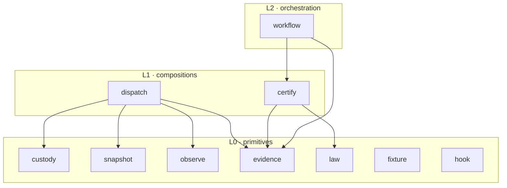

# Re-abstracting the dev-lane mini-apps by capability — design proposal

**Standing: PROPOSAL, not law. Nothing below is built, ratified, or in
force.** This document exists to be ratified, amended, or rejected by
the owner — that act is what would make any of it real. Every factual
claim about the current tree was measured against `dev` and the named
commits, not recalled; re-derive them, don't trust them (the commands
are cited inline).

Owner's directive, restated once so scope stays anchored:
*"These dev-lane mini-apps need to be abstracted based on capability."*

The apps today are carved by **accretion, not capability**: a mini-app
holds whatever landed in it, so one app ends up owning several unrelated
things and another owns a slice of a thing. The §Dispatch relocation now
in flight is the capability principle applied to exactly one tangle.
This document generalizes it to the whole set.

---

## 0 · What was measured, and the one correction it forces

The directive names a `task → harness` prohibition, a `launch.py`, and
`ops/contracts/imports.py`. All three are real — **on `dev` and `main`,
not on the branch this document was drafted from.** The working branch
(`workflow/cue-contracts`) is a narrow slice that carries only
`fixtures`, `harness`, `hooks`, `telemetry`, `workflow`. The full,
canonical app set lives on `dev`:

```
$ git ls-tree --name-only dev:ops/devlane/
fixtures  harness  hooks  task  telemetry  workflow
```

So the directive's "known set to verify" — task, harness, workflow,
fixtures, telemetry, hooks — is **confirmed exactly** against `dev`.
Everything below reads from `dev` and from the dispatch work on
`task/dispatch-contract` (PR #61, tip `36c1d7d`), because that is where
`launch.py` actually is.

---

## 1 · The problem, made concrete: accretion, and Exhibit A

### 1.1 The current import graph, as it really is

The graph is not a diagram in a doc — it is a **CI-enforced check**.
`ops/contracts/imports.py` parses every app's Python, finds each
cross-app reference (a real `import`, a `/`-joined path segment naming
another app, or a module-loader argument), and refuses any edge not
declared in `ops/contracts/imports.json`. It is registered to run in CI:

```
$ git show dev:ops/devlane/workflow/gate-kinds/artifact.json | grep imports
"argv": ["python3", "ops/contracts/imports.py"], "ci": true
```

The declared graph on `dev` (`git show dev:ops/contracts/imports.json`):

```
fixtures   -> {}
harness    -> {}
hooks      -> {}
task       -> {telemetry}
telemetry  -> {}
workflow   -> {}
```

**One edge in the entire lane: `task → telemetry`.** Its own comment
says why: `run.py` loads `telemetry/breaker.py` by path to supervise a
dispatched agent. Concretely, `dev:ops/devlane/task/run.py:90`:

```python
Path(__file__).resolve().parent.parent / "telemetry" / "breaker.py"
```

That `/ "telemetry"` is what the checker sees as the edge — and it is
declared, so it is clean. So far the graph is honest.

### 1.2 Exhibit A — dispatch buried inside `task`, forcing a forbidden edge

`task` was meant to be a **calling convention plus a harness-agnostic
runner** (`CONTRACT.md`: *"a standard, token-efficient way to run
delegated work"*). Its runner `run.py` is deliberately
harness-independent — it picks a harness *by name*, never by importing
the harness app, which is exactly why `task → harness` never had to
exist.

Then the **§Dispatch policy** landed inside the same app. PR #61 added
`launch.py` — *"the policy over [run.py], and the sole dispatch path for
dev-lane work"* — at `ops/devlane/task/launch.py`. Unlike the runner, the
policy genuinely needs the harness primitives. From `36c1d7d`:

```python
# ops/devlane/task/launch.py
HARNESS_APP = APP.parent / "harness"                    # line 27
...
isolation = _module("isolation", HARNESS_APP / "isolation.py")   # line 143
iso_env, flags = isolation.isolated(name, job_dir/"home"/name, env)
spec = isolation.HARNESSES[name]
```

That `APP.parent / "harness"` is a `/`-joined constant `"harness"`,
which is an app name — so `imports.py`'s `path_join_constants` rule
records a **`task → harness`** edge (evidence: `path segment "harness"
(line 27)`). But the declaration at that very commit is unchanged:

```
$ git show 36c1d7d:ops/contracts/imports.json | grep -A1 '"task"'
"task": {"may_import": ["telemetry"]},
```

`task → harness` is **not declared**, the check is **CI-required**, and
**no branch anywhere grants the edge** (verified by scanning every local
branch's `imports.json`). So the dispatch policy, as located today, sits
on a latent violation of a check that exists specifically to catch
exactly this: a capability reaching into another app that nobody
declared it may.

The wrong fix is to add `task → harness` to the declaration — that
permanently couples the *calling convention* to the *custody
primitives*, recording a dependency that is not `task`'s at all. **The
right fix is that dispatch is not `task`'s content.** Dispatch is its
own capability, and it composes over custody. That is the relocation in
flight, and §4 below is what makes it general.

### 1.3 The accretion inventory (why "by capability" is the axis)

`task` is not the only accreted app; it is the one that hit the wall
first. Measured contents, per app:

| app | what it actually holds today | how many distinct things |
|:--|:--|:--|
| `task` | job/envelope **contract** (`CONTRACT.md`, `envelope.py`) · **dispatch policy** (`launch.py`) · harness-agnostic **runner** (`run.py`) · **snapshot** (`fileset.py`) · **verify** primitive (`verify.py`) · **dispatch record** (`record.py`) · job **catalog** (`jobs.json`) | ~5 |
| `harness` | **custody/isolation** (`isolation.py`, `probe.py`) · **snapshot firewall** (`stage.py`) · the dispatch **schema/law** (`context.cue`: `#Context`/`#Dispatchable`/`#Task`/`#Brief`) · **breaker thresholds** (`wires.py`) | ~4 |
| `workflow` | append-only **evidence ledger** (`chain.py`, `cas.py`, `receipts.py`, `store.py`, `query.py`) · **gate/stage machinery** (`gatekinds.py`, `gate-kinds/`) · **CI checks** (`checks/`) · **certify** machinery (`contracts/` — `cue vet`, `extract/`, `packets/`) · read-only **MCP** (`mcp_server.py`) · **coord** | ~5 |
| `telemetry` | supervision **circuit-breaker** (`breaker.py`) · live **pulse** (`pulse.py`) · **usage accounting** (`usage.py`) · **worth/cost** (`worth.py`) | ~1 (coherent) |
| `fixtures` | synthetic session **stores** for tests (`stores.py`) | 1 (coherent) |
| `hooks` | git **lifecycle** hooks (`commit-msg`, `post-commit`, `post-checkout`) | 1 (coherent) |

The three coherent apps (`telemetry`, `fixtures`, `hooks`) are already
capability-shaped — one thing each. The three overloaded apps (`task`,
`harness`, `workflow`) are where a capability leaks across a boundary or
two capabilities share a boundary. That asymmetry is the whole thesis:
**where an app is one capability it is healthy; where it is several, the
edges strain.**

---

## A · "Capability" as the organizing axis

**A capability is a single coherent thing the dev-lane can *do*, that
satisfies all four of these — a definition each of which is testable:**

1. **One contract.** Exactly one closed statement of what it guarantees,
   its inputs, and its refusals — the shape a certifier (`law`, §E)
   binds to. If two unrelated contracts live in one app, it is two
   capabilities. *(Test: can you write its guarantees without the word
   "and also"?)*
2. **One public surface.** One named set of entry points other
   capabilities call; everything else is private. *(Test: `grep` the
   cross-app references into the app — do they all land on one coherent
   surface, or on two unrelated ones?)*
3. **One declared place in the layering.** Its out-edges in
   `imports.json` are exactly the lower capabilities it composes — no
   more (an undeclared reach, Exhibit A) and no fewer (a hidden reach).
   *(Test: `imports.py` runs clean AND the declared edges match the
   capability's stated dependencies.)*
4. **One reason to change.** It changes when its one job changes, never
   as a side effect of an unrelated job in the same app. *(Test: would a
   change to thing X ever force a recompile/retest of unrelated thing Y
   because they share a module? If yes, they are miscarved.)*

**Contrast with today's accretion axis:** an app is currently "whatever
landed here." Its contract is implicit and multiple (`task` has a
job/envelope contract *and* a dispatch contract). Its surface is
whatever other apps happen to import. Its layering is discovered after
the fact by a checker refusing a merge (Exhibit A) rather than declared
up front. The capability axis inverts that order: **declare the
capability and its layer first; the app boundary is then a consequence,
not a coincidence.**

A capability maps to **one app directory** under `ops/devlane/`, with one
`CONTRACT.md` and one row in `imports.json`. "Re-abstract by capability"
means: make the app boundaries coincide with the capability boundaries.

---

## B · Capability inventory

The directive's candidate set, refined against what the code actually
provides. Each capability lists its **contract** (what it guarantees),
its **inputs**, and **what it may depend on** (its declared out-edges).
"L0" = primitive (no internal dependency); "L1/L2" = composition.

### B1 · `custody` (isolate) — **L0 primitive**
- **Guarantees:** a harness process runs with only the credentials it is
  handed and none of the operator's config; an unlisted harness is
  *refused*, never launched blind; the isolation is *re-verifiable*
  against the live binary, and "the question was never asked" reports as
  INVALID, never as a pass.
- **Provides:** `isolation.py` (`HARNESSES`, `isolated()`, `build_home`,
  `dispatch_env`, `dispatch_flags`, `NotIsolated`) · `probe.py`
  (`structural`, `behavioural`, `Result`, INVALID-not-pass).
- **Inputs:** a harness name, a target HOME root, an environment.
- **Depends on:** nothing internal.

### B2 · `snapshot` (custody of the *tree*) — **L0 primitive**
- **Guarantees:** a role's working tree is built from a `given`/`withheld`
  manifest with *withheld always winning*, and the firewall is **proved
  in both directions** before the directory is handed back (nothing that
  should be excluded got in; nothing that should be included is missing —
  an empty snapshot must not trivially pass). Refuses to return an
  unproven snapshot.
- **Provides:** `stage.py` (`stage`, `prove`, `plan_files`,
  `dispatch_spec`, `FirewallBreach`) **+ `fileset.py`** (today stranded
  in `task`), merged into one snapshot surface.
- **Inputs:** a manifest, a role name, a destination, a source tree/ref.
- **Depends on:** nothing internal. *(Candidate to fold into `custody`
  — see Decision 1.)*

### B3 · `observe` (telemetry) — **L0 primitive**
- **Guarantees:** a running dispatch is supervised by a circuit-breaker
  that trips on measured wire thresholds (stall, budget) and terminates
  a runaway tree; spend and idle are accounted per repo; tokens-out is
  the live signal, raw totals disabled as cache-dominated.
- **Provides:** `breaker.py` (`Battery`, `trip`, `terminate_tree`) ·
  `pulse.py` · `usage.py` · `worth.py` **+ `wires.py`** (the breaker
  thresholds, today stranded in `harness`).
- **Inputs:** a pid/pgid to watch, wire thresholds, session stores to read.
- **Depends on:** nothing internal.

### B4 · `evidence` (record) — **L0 primitive**
- **Guarantees:** an append-only, hash-chained, content-addressed record;
  every entry stamped to the commit it is true of; a reader cannot be
  shown a record that was silently recomputed or detached from its commit.
- **Provides:** `chain.py`, `cas.py`, `receipts.py`, `store.py`,
  `query.py`, `canonical.py` (the `wf` ledger) — and the **dispatch
  record** (`record.py`, today in `task`) is a *second consumer* of the
  same primitive, not a second primitive (see Decision 3).
- **Inputs:** an event/record and an identity; a query.
- **Depends on:** nothing internal.

### B5 · `law` (authority) — **L0 primitive**
- **Guarantees:** the closed, versioned semantic authority for the
  dev-lane — one named contract per capability, the lexicon they are
  written in, and the judgment register — with `open`/`_`/`inferred`
  banned in favor of named refusals and `#Unresolved` sentinels. Already
  designed in full: `.dev/xor/out/law-mini-app-design.md`.
- **Provides:** the contract set (`#Contract`, `#Provenance`, `#Gap`),
  the lexicon wall's single source, the certify schema. The existing
  `harness/context.cue` (`#Context`/`#Dispatchable`) is *already*
  law-shaped and is where `law`'s schema is seeded from.
- **Inputs:** scope/prose and owner ratification (never code).
- **Depends on:** nothing internal (never cites code, a path, or a line).

### B6 · `certify` (gate) — **L1 composition over {evidence, law}**
- **Guarantees:** a capability's code *agrees* with its contract (`cue
  vet` over a frozen packet), the agreement was *earned* (relational
  gates: closure, citation-resolution, presence-before-inference), and a
  stale or broken certified edge *refuses CI* rather than passing
  quietly. Every contract ships a positive control **and** a negative
  attack that must draw its named refusal.
- **Provides:** `workflow/contracts/` (`vet.py`, `cue/`, `extract/`,
  `packets/`) · the registered `workflow/checks/` · the **app-graph
  check `ops/contracts/imports.py` itself** (a certify function over the
  layering) · `gate-kinds/`.
- **Inputs:** a contract (from `law`), an observation of code, a commit.
- **Depends on:** `evidence` (receipts of what vetted), `law` (the
  contracts it certifies against). *(One capability or split shape-vs-
  earned-ness — Decision 4.)*

### B7 · `dispatch` (launch) — **L1 composition over {custody, snapshot, observe, evidence}**
- **Guarantees:** the sole dispatch path for dev-lane work: mint a
  snapshot from a named ref, isolate the harness, supervise inline,
  collect, return the typed envelope, and write a tamper-evident
  dispatch record — applying §Dispatch's refusal table before anything
  is minted.
- **Provides:** `launch.py` + `run.py` + `record.py` + `envelope.py` +
  `jobs.json` (relocated out of `task`).
- **Inputs:** a job name, a harness, a model, a ref, a scope.
- **Depends on:** `custody` (isolate), `snapshot` (mint the tree),
  `observe` (breaker), `evidence` (the record). **These four edges are
  the honest replacement for the single forbidden `task → harness`.**

### B8 · `workflow` / `wf` — **L2 composition over {evidence, certify}**
- **Guarantees:** the stage/gate orchestration and the read-only MCP —
  drives work (`wf` CLI), records nothing itself that `evidence` does not
  hold, refuses nothing that `certify` does not check.
- **Provides:** `wf.py`, `coord.py`, `gatekinds.py`, `mcp_server.py`,
  `mcp_launch.py`.
- **Depends on:** `evidence`, `certify`.

### B9 · `fixture` — **L0 primitive**
- **Guarantees:** deterministic synthetic session stores so the other
  capabilities' suites need no live harness or token. Provides
  `fixtures/stores.py`. Depends on nothing internal. Already clean.

### B10 · `hook` — **L0 primitive**
- **Guarantees:** git-lifecycle enforcement at commit/checkout time.
  Provides `hooks/`. Depends on nothing internal. Already clean.

---

## C · Current → capability mapping (where capabilities leak)

| current app | capabilities it holds | leak / conflation |
|:--|:--|:--|
| `task` | **dispatch** (`launch.py`,`run.py`,`record.py`,`envelope.py`,`jobs.json`) · **snapshot** (`fileset.py`) · a job of **certify**/verify (`verify.py`) · the job/envelope **contract** (→ `law`) | **Exhibit A:** `dispatch` needs `custody`, but sits in `task`, whose declared edges are `{telemetry}` only → latent, CI-forbidden `task → harness` (`launch.py:27`). Also `fileset.py` is `snapshot` stranded away from `stage.py`. |
| `harness` | **custody** (`isolation.py`,`probe.py`) · **snapshot** (`stage.py`) · **law/schema** (`context.cue`) · **observe** config (`wires.py`) | Four capabilities in one app. `wires.py` (breaker thresholds) is `observe` config living in `harness`; `context.cue` is `law` living in `harness`. The name "harness" describes a *subject*, not a capability. |
| `workflow` | **evidence** (`chain`,`cas`,`receipts`,`store`,`query`) · **gate/stage** (`gatekinds`,`gate-kinds`) · **certify** (`contracts/`) · **MCP/orchestration** (`wf.py`,`coord`,`mcp_*`) · **checks** (`checks/`) | Five capabilities. The append-only ledger (a primitive) and the orchestrator (a composition over it) share one app, so nothing can depend on the ledger without depending on the whole of `wf`. |
| `telemetry` | **observe** | clean — but is *missing* `wires.py`, which lives in `harness`. |
| `fixtures` | **fixture** | clean. |
| `hooks` | **hook** | clean. |
| `ops/contracts/` | **certify** (the app-graph check) | a certify function that lives *outside* `ops/devlane/` — correct instinct (it governs the app set), but unnamed as a capability. |

### The `task`/`harness`/`dispatch` tangle, worked end to end

- **Before:** `run.py` (harness-agnostic runner) legitimately needs only
  `observe` → `task → telemetry`, declared, clean. Then `launch.py`
  (dispatch **policy**) is added to the *same app* and needs
  `custody`+`snapshot`+`observe`+`evidence`. Because it lives in `task`,
  every one of those reaches becomes a `task → X` edge. `task → harness`
  is the one that trips the check.
- **The miscarving:** `task` is trying to be two capabilities at once —
  a *calling convention* (thin, depends on little) and a *dispatch
  engine* (thick, composes four primitives). One app, two contracts, two
  reasons to change: fails definition A1 and A4.
- **After (§D):** `dispatch` is its own app. It declares `dispatch →
  {custody, snapshot, observe, evidence}` — four honest edges. No app
  named `task` reaches `harness`, because the reach never belonged to the
  calling convention; it belonged to the engine, and the engine now has
  its own name and its own row in the graph.

---

## D · The target decomposition — a clean acyclic DAG

### D1 · Layers

```
L0  primitives (no internal edge):
      custody   snapshot   observe   evidence   law   fixture   hook
L1  compositions over L0:
      dispatch  = custody + snapshot + observe + evidence
      certify   = evidence + law
L2  compositions over L1/L0:
      workflow  = evidence + certify
```

### D2 · The declared edges (the target `imports.json`)

```
custody   -> {}
snapshot  -> {}          (or -> {custody}; Decision 1)
observe   -> {}
evidence  -> {}
law       -> {}
fixture   -> {}
hook      -> {}
dispatch  -> {custody, snapshot, observe, evidence}
certify   -> {evidence, law}
workflow  -> {evidence, certify}
```

Every edge points **strictly downward** (Lk → L<k). No edge points up
or sideways within a layer, so the graph is acyclic by construction.

### D3 · Diagram



ASCII (the same graph, and the edge that disappears):

```
                         workflow (L2)
                        /            \
                   certify (L1)       \____________
                   /       \                        \
                  /         \                         \
   dispatch (L1) ─┬── custody (L0)                     \
                  ├── snapshot (L0)                      \
                  ├── observe (L0)                        \
                  └── evidence (L0) ◄──── certify ◄──── workflow
                          ▲
                          │
        law (L0)  ────────┘ (via certify)
        fixture (L0)   hook (L0)   [no internal edges]

   GONE:  task ──✗──► harness      (the CI-forbidden edge; see below)
```

### D4 · Why `task → harness` is gone — not excepted, dissolved

The edge existed only because a **composition** (dispatch) was living
inside a **thin app** (task) whose declared layer did not include the
primitives dispatch composes. Once dispatch is its own L1 node:

- `dispatch → custody` is a **declared, first-class edge** — the honest
  statement that the launcher isolates the harness. It is not an
  exception to a rule; it is the rule (an L1 capability declaring the L0
  primitive it composes).
- There is **no app named `task` reaching an app named `harness`**,
  because "harness" as an app dissolves into `custody` + `snapshot`, and
  the reach belonged to `dispatch`, never to the calling convention.
- The check `ops/contracts/imports.py` goes from *latent violation* to
  *clean* without a single `--override` and without adding a coupling
  that isn't real: the four `dispatch → …` edges are all true, all
  declared, all downward.

**The graph is acyclic:** primitives have no out-edges; every
composition's out-edges land strictly in a lower layer; no cycle is
representable.

---

## E · What falls out for free

### E1 · The harness-config primitive becomes a clean capability

The owner has called `harness/{isolation,probe,context.cue,stage,wires}`
"the harness-config primitive." Today that phrase names **four**
capabilities wearing one app's coat. Under §D each finds its home:

- `isolation.py` + `probe.py` → **`custody`** — one contract: *"a
  harness runs with only what it was handed, and the isolation is
  re-verifiable or INVALID."* The `HARNESSES` dict + `auth_files` (the
  only thing allowed to cross from the operator's config) is now the
  single, nameable "harness-config" surface — a genuine primitive with
  one contract and one reason to change (a new harness, or a changed
  leak).
- `stage.py` (+ `task/fileset.py`) → **`snapshot`** — the tree-custody
  half, no longer split across two apps.
- `context.cue` → **`law`** — it is already `#Context`/`#Dispatchable`,
  the closed observation shape and the stricter dispatchable law. It was
  never harness *code*; it is the *contract* dispatch is certified
  against. law-mini-app-design.md §3.2 already names it as law's seed.
- `wires.py` → **`observe`** — breaker thresholds are telemetry config.

What was one overloaded, subject-named app becomes clean capabilities,
each with one contract the certifier can bind to.

### E2 · The `law` app's job gets strictly easier

`law` (`.dev/xor/out/law-mini-app-design.md`) certifies each mini-app
against a contract. Its hard case today is that **app boundaries don't
equal contract boundaries**: to certify `task` it would have to write a
contract spanning a job schema *and* a dispatch policy *and* a runner;
to certify `workflow` it faces five capabilities. Capability abstraction
makes the mapping a **bijection**:

- **one capability ⇒ one `#Contract` ⇒ one app** — `law` certifies
  `dispatch` against the dispatch contract, `custody` against the
  custody contract, and so on. No contract straddles two apps; no app
  hosts two contracts. That is precisely the shape law's `#Contract`
  (`parties: {client, supplier}`, one supplier app per contract) assumes.
- law's own §2.2 worklist (the twelve PLAN.md regions) and this
  re-abstraction converge: both are "name the closed thing, give it one
  home." Doing the capability carve *first* means law never has to certify
  a boundary it will then have to re-draw.
- `certify` itself becomes a named capability with a contract (B6),
  including the app-graph check `ops/contracts/imports.py` — so "the
  layering is correct" is itself a certified, CI-enforced guarantee,
  not a checker nobody named.

---

## F · Migration path — ratification-gated, incremental, no big bang

Each step is independently landable and green (imports check clean,
tests green, one dispatched record per step). Steps marked **[RATIFY]**
cannot proceed on inference. **Step 1 is the §Dispatch relocation
already in flight — this path begins with it, it does not contradict it.**

| step | what happens | gate |
|:--|:--|:--|
| **0** | Owner ratifies the capability axis (§A), the target set (§B), the target DAG (§D), and the names. Everything downstream is a mechanical consequence of this ratification. | **[RATIFY]** |
| **1** | **Relocate dispatch.** Move `launch.py` + `run.py` + `record.py` + `envelope.py` + `jobs.json` from `ops/devlane/task/` into a new `ops/devlane/dispatch/`. Add `dispatch → {custody(harness), observe(telemetry), evidence}` to `imports.json`; drop `task → telemetry`. **This is the fix in flight** — after it, `imports.py` is clean with no override, and the `task → harness` violation is structurally impossible. | mechanical; the imports check is the gate and it goes green |
| **2** | **Free `snapshot`.** Merge `task/fileset.py` into `stage.py` under one snapshot surface; point `dispatch → snapshot`. (If `snapshot` becomes its own app vs. folds into `custody`: Decision 1.) | mechanical; one commit |
| **3** | **Relocate `observe` config.** Move `wires.py` `harness → telemetry`. `harness`'s remaining code is now exactly `custody`. | mechanical; one commit |
| **4** | **Rename to capabilities.** `harness` app → `custody` (isolation+probe); its `context.cue` earmarked for `law` (step 6). Update `imports.json` app keys and every path literal in one dispatched, recorded commit. | mechanical; the graph check refuses if a stale path literal remains |
| **5** | **Decide `task`'s fate** — dissolve into `dispatch` + `law`, or keep as a thin calling-convention façade over `dispatch`. | **[RATIFY]** — Decision 2 |
| **6** | **Land `law`** per `law-mini-app-design.md`; move `context.cue`'s `#Context`/`#Dispatchable` under it; stand up `certify` as a named capability (including `ops/contracts/imports.py`). | **[RATIFY]** per that document's own step 0 |
| **7** | **Split `workflow`** (optional, last): lift `evidence` (`chain`/`cas`/`receipts`/`store`/`query`) into its own primitive app so `certify` and `dispatch` depend on the ledger without depending on the `wf` orchestrator. | **[RATIFY]** — Decision 3, and only after 1–6 are green |

No step downstream of an unratified **[RATIFY]** may begin. The
sequence is deliberately "compositions first, primitives renamed second,
`law` last," so that the risky move (relocating the running dispatch
path) is step 1 while the graph check is watching, and the cosmetic
moves (renames) come after the coupling is already honest.

---

## G · Open decisions for the owner

Genuine forks — the owner's call, not this document's:

1. **`snapshot` — its own capability, or part of `custody`?** Both are
   "custody": one of the *identity/config* a harness runs with
   (`isolation`/`probe`), one of the *tree* it may see (`stage`/
   `fileset`). One app `custody` with two surfaces, or two primitives
   `custody` + `snapshot`? (Recommendation: two — they have different
   contracts and different reasons to change, satisfying A1/A4; but they
   always travel together in `dispatch`, which argues for one.)

2. **Does `task` survive as a capability, or dissolve?** Its parts map
   cleanly elsewhere: envelope/runner/record/catalog → `dispatch`;
   job/envelope contract → `law`; `verify` → a job. Keeping a thin
   `task` façade preserves the `task(job, context, require, runtime)`
   calling convention as a named surface; dissolving it removes an app.
   (Recommendation: dissolve — the calling convention is `dispatch`'s
   public surface, not a separate capability.)

3. **`evidence` — one primitive with many consumers, or split?** The
   `wf` chain and the dispatch record are two ledgers today, and
   law-mini-app-design.md §4.3 even argues law's receipts must not share
   `wf`'s MCP instance. Is `evidence` one primitive both `dispatch` and
   `certify` consume, or does each ledger stay embedded in its consumer?
   (Recommendation: one primitive, two schemas — but this is the
   load-bearing lane-partition question, so it is the owner's.)

4. **`certify` — one capability, or split shape-vs-earned-ness?**
   law-mini-app-design.md §3.4 already separates `cue vet` (shape
   agreement) from relational gates (presence/closure — did it *earn*
   it) from receipts. Model that as one `certify` capability with three
   internal layers, or as `certify` (shape) + `gate` (earned-ness) as
   two capabilities? (Recommendation: one — they are inseparable by that
   document's own argument.)

5. **Naming.** `custody` vs `isolate` vs keeping `harness`; `dispatch`
   vs `launch`; `observe` vs keeping `telemetry`; `evidence` vs `record`
   vs keeping `workflow`. Names are cheap to bikeshed and expensive to
   churn once path literals bind them — ratify them once, at step 0.

6. **`ops/devlane/` vs a two-tier layout.** Does the layering (L0/L1/L2)
   get reflected on disk (e.g. `ops/devlane/primitives/…`), or stay flat
   with the layer recorded only in `imports.json`? (Recommendation: flat
   — the graph check already carries the layering; a directory tier
   would duplicate it and could drift.)

---

## Sources

Measured against `dev` and the named commits on 2026-08-27:
`git ls-tree dev:ops/devlane/`; `ops/contracts/imports.json` and
`imports.py` (on `dev`); `ops/devlane/workflow/gate-kinds/artifact.json`
(the `imports` check, `ci:true`); `ops/devlane/task/{CONTRACT.md,run.py,
jobs.json}` (on `dev`); `ops/devlane/task/launch.py` and the §Dispatch
section of `CONTRACT.md` (on `task/dispatch-contract`, tip `36c1d7d`,
PR #61); `ops/devlane/harness/{isolation,probe,stage,wires}.py` and
`context.cue`; `ops/devlane/telemetry/{breaker,pulse,usage}.py`;
`ops/devlane/fixtures/stores.py`; `ops/devlane/hooks/`;
`.dev/xor/out/law-mini-app-design.md`;
`.dev/xor/out/countract-2/two-contracts-aligning.md`;
`.dev/xor/ONBOARDING.md`, `HANDOFF.md`, `OVERNIGHT.md`.
Cross-branch check (no branch grants `task → harness`): scan of every
local branch's `ops/contracts/imports.json`.
